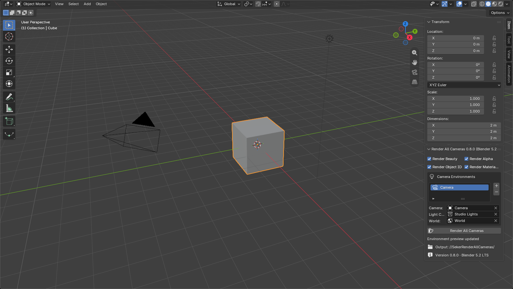

# Render All Cameras for Blender

> **0.8.0 发布候选：88 项通过、6 项失败，尚未正式发布。** 下方 0.8.0 下载链接将在发布后生效；当前正式版仍为 [v0.7.0](https://github.com/Seker800/SekerRenderAllCameras/releases/tag/v0.7.0)。已知限制与验证记录见 [0.8.0 发布验证](Docs/过程产物/review/BLOCKED-0.8.0发布验证.md)。

## ⬇️ Download / 下载插件

### 第 1 步：确认自己的 Blender 版本

打开 Blender，在顶部菜单选择 **帮助（Help）→ 关于 Blender（About Blender）**，记下版本号。

### 第 2 步：点击对应版本下载

| 你的 Blender 版本 | 点击这里下载插件 |
|---|---|
| **4.0.2–4.0.x** | **[⬇️ Render All Cameras 0.8.0 · Blender 4.0.2](https://github.com/Seker800/SekerRenderAllCameras/releases/latest/download/RenderAllCameras-0.8.0-blender-4.0.2.zip)** |
| **4.1.1–4.1.x** | **[⬇️ Render All Cameras 0.8.0 · Blender 4.1.1](https://github.com/Seker800/SekerRenderAllCameras/releases/latest/download/RenderAllCameras-0.8.0-blender-4.1.1.zip)** |
| **4.2.x** | **[⬇️ Render All Cameras 0.8.0 · Blender 4.2.0](https://github.com/Seker800/SekerRenderAllCameras/releases/latest/download/RenderAllCameras-0.8.0-blender-4.2.0.zip)** |
| **4.5.x LTS** | **[⬇️ Render All Cameras 0.8.0 · Blender 4.5 LTS](https://github.com/Seker800/SekerRenderAllCameras/releases/latest/download/RenderAllCameras-0.8.0-blender-4.5-lts.zip)** |
| **5.2.x LTS** | **[⬇️ Render All Cameras 0.8.0 · Blender 5.2 LTS](https://github.com/Seker800/SekerRenderAllCameras/releases/latest/download/RenderAllCameras-0.8.0-blender-5.2-lts.zip)** |

> 下载得到 `.zip` 文件后，**不要解压**。也不要下载页面底部 GitHub 自动提供的 `Source code (zip)`，它不是可安装的插件。
> ZIP 文件名和 Blender 安装列表、面板名称都标明插件版本及目标 Blender 版本，例如 **Render All Cameras 0.8.0 (Blender 4.0.2)**。内部模块标识仍为 `camera_batch_renderer`，升级时不会生成另一款插件。

### 第 3 步：在 Blender 中安装

- **Blender 4.0 / 4.1：**打开 **编辑 → 偏好设置 → 插件 → 安装**，选择刚下载的 ZIP，然后勾选启用 **Render All Cameras**。
- **Blender 4.2 / 4.5 / 5.2：**打开 **编辑 → 偏好设置 → 获取扩展**，点击右上角菜单，选择 **从磁盘安装**，然后选择刚下载的 ZIP。

**更新已有插件后必须重启 Blender：**先保存正在编辑的内容，完全退出 Blender（关闭所有窗口），再重新打开。安装列表可能已显示 0.8.0，但未重启的面板仍在运行旧版代码（例如显示 Version 0.6.0、缺少 Beauty 开关）。重启后请在面板底部确认版本为 **0.8.0**，并确认能看到 **Render Beauty** 选项；未确认前不要开始批量渲染。

如果表格里没有你的 Blender 版本，表示该版本目前没有经过完整测试，请不要随便选择其他版本的包。全部文件也可以在 **[v0.8.0 发布页面](https://github.com/Seker800/SekerRenderAllCameras/releases/tag/v0.8.0)** 查看。

**One-click batch rendering for every camera in a Blender scene.** Render still images with
automatic filenames, per-camera light/World environments, optional alpha masks, Object ID maps,
Material ID maps, and JSON manifests.

一键逐个渲染 Blender 当前场景中的全部摄影机，并自动输出规范命名的静帧、Alpha、Object ID、
Material ID 和 JSON 清单。

[](https://github.com/Seker800/SekerRenderAllCameras/releases/latest)
[](#whats-new-in-080)
[](#compatibility)
[](LICENSE)

> Download the package whose name exactly matches Blender 4.0.2, 4.1.1, 4.2.0, 4.5 LTS, or
> 5.2 LTS. Do not unzip it and do not substitute a package from another Blender line.
>
> This branch contains the **0.8.0 candidate**. The public stable release remains **0.7.0**
> until the validation failures are resolved or an explicit release decision is made.

## Plugin at a glance

[](Docs/images/plugin-quick-start.jpg)

Save the `.blend`, press <kbd>N</kbd> in the 3D Viewport, open **Batch Render**, choose at least one of
Beauty/Alpha/Object ID/Material ID, and click **Render All Cameras**. Beauty starts enabled. The plugin
renders every usable camera to the fixed `SekerRenderAllCameras/` folder next to the saved `.blend`.

中文：保存 `.blend`，在 3D 视图按 <kbd>N</kbd>，打开 **Batch Render**；从 Beauty / Alpha / Object ID /
Material ID 中至少勾选一项（Beauty 默认开启），然后点击 **Render All Cameras**。上图点击可查看原始尺寸。

## What's new in 0.8.0

- Open Blender's Render Result window for batch progress; wait for native Cycles/EEVEE jobs to
  finish before committing outputs or switching cameras.
- Switch only registered preset Collection roots; preserve object flags, hidden children and
  unrelated Collections.
- Retry brief Windows staging-file locks, show startup errors, and reduce Alpha/ID export memory.
- Preserve one diagnostic JSON per request, including failures before rendering starts. Click
  **Open Diagnostics** and send the relevant `Render-*.json` files when reporting a problem.
- Fix filename collisions, Alpha reuse after compositing, failure recovery, stop-between-images,
  persistent handlers after file loading, ID scene context and cropped output dimensions.

中文：渲染时打开结果窗口；预设只切换登记的集合根；修复短暂文件占用、文件名冲突、Alpha 复用和异常恢复等问题。报错时点击 **Open Diagnostics**，发送对应 JSON 即可。默认位置为 `.blend` 同级的 `SekerRenderAllCameras/Diagnostics/`；不可写时尝试系统临时目录下的 `RenderAllCameras-Diagnostics/`。记录含版本、设备、摄影机、通道、路径、异常和最后检查点，不自动上传，重试不会覆盖旧记录。

### Included in 0.6.0

- Publish five separately bounded packages for Blender 4.0.2, 4.1.1, 4.2.0, 4.5 LTS, and 5.2 LTS.
- Run the same background, GUI, stress, wrong-version, installed-package, and semantic-contract
  gates against every target; a pass on one Blender version cannot substitute for another.
- Require GitHub assets to match the SHA-256 of the locally tested packages before release closure.

中文：0.6.0 为五个 Blender 目标分别构建、测试和发布，不再提供模糊的通用包；发布后还会下载线上资产并与本地已测试包逐字节校验。

### Material ID included since 0.5.0

- Add an optional Material ID PNG for every camera. Each Blender Material receives a deterministic,
  non-black flat color; different material slots on the same mesh remain distinct.
- Surfaces without a material receive an explicit `Unassigned` color instead of disappearing into
  the black background.
- Write `{Blend}_MaterialID.json` with material keys, display names, exact RGB values, hex colors,
  and skipped geometry.
- Material ID rendering uses an isolated temporary Workbench scene and does not modify the user's
  materials, nodes, material slots, or face assignments.

中文：0.5.0 新增 Material ID 通道。同一材质在不同物体、摄影机和重复运行中保持同一颜色；同一模型的不同材质面会输出不同颜色；没有材质的表面使用单独的 `Unassigned` 标签。插件不会修改用户材质或面分配。

### Camera environments included

- Pair any camera with an optional light Collection, an optional Blender World, or both.
- Selecting a pairing immediately previews its camera, light rig, and World in the current scene.
- While a paired camera renders, its registered preset Collection is enabled and other registered
  preset Collections are hidden. Object flags, manually hidden children, parents, and unregistered
  Collections keep their visibility. Use dedicated light Collections; non-light objects in a preset
  follow their Collection. Render-time changes are restored afterward.
- Unpaired cameras keep the scene state captured at batch start. All render-time visibility and
  World changes are restored after completion, cancellation, or failure.
- Output still uses the fixed `SekerRenderAllCameras/` folder: new matching images replace old ones,
  while images not generated in the current run remain untouched.

中文：选中配对行切换摄影机、已登记灯组集合根和 World；保留对象、子集合、父级及无关集合的手动显隐。批次开始时打开原生渲染结果窗口，Cycles/EEVEE 异步执行并显示进度，完成、取消或失败后恢复批次前状态。

### Validation and known limits

The 0.8.0 candidate targets Blender **4.0.2, 4.1.1, 4.2.0, 4.5.13 LTS and 5.2.1 LTS**.
Release validation covers real renders, installed packages, all four channels, cancellation,
failure recovery and protected user preferences. The complete suite returned **88 passed / 6 failed / 0 not_run**. All five installed-package
contracts passed; the native GUI failures below still block normal release qualification.
The release notes record the actual results.

Cycles tests on this machine use CPU. Reports of missing GPU outputs are not confirmed resolved.
Native Intel/OpenGL render-window and shutdown failures have occurred on this machine; successful
short batches do not establish that those failures are fixed. An unfinished diagnostic JSON records
the last checkpoint, not a native crash stack or a confirmed cause. Startup may also spend time
compiling kernels before progress becomes visible.

中文：五个目标分别验证，准确测试结果见本版发布说明。当前机器仅覆盖 Cycles CPU；朋友现场的 GPU 不出图原因尚未确认。测试中出现过原生 Intel/OpenGL 渲染窗口及退出异常，不能以短批次通过宣称彻底解决。诊断文件保留最后检查点，原生崩溃未必能留下 Python 报错。

## Why use it?

- Render every camera in the current Scene with one click—built for still images, not animation.
- Keep the current Blender render settings for Beauty output.
- Give each camera its own light Collection and World without duplicating the scene.
- Add an optional lossless grayscale Alpha mask for each camera.
- Add an optional exact-color Object ID map plus a machine-readable color mapping JSON.
- Add an optional exact-color Material ID map plus a machine-readable material mapping JSON.
- Name files from the `.blend` file, camera, channel, resolution, and render engine.
- Reuse one `SekerRenderAllCameras/` folder: newly rendered files replace matching old files, while
  outputs not generated in the current run remain untouched.
- Track progress, cancel cooperatively, record failures, and restore the active camera and settings.

Example filenames:

```text
ProductShot_Camera_Front_Beauty_1920x1080_Cycles.png
ProductShot_Camera_Front_Alpha_1920x1080.png
ProductShot_Camera_Front_ObjectID_1920x1080_Object.png
ProductShot_Camera_Front_MaterialID_1920x1080_Material.png
ProductShot_RenderInfo.json
ProductShot_ObjectID.json
ProductShot_MaterialID.json
```

## Install

### Blender 4.2.0, 4.5 LTS, or 5.2 LTS

1. Download the matching ZIP from the download table at the top of this page.
2. In Blender, open **Edit → Preferences → Get Extensions**.
3. Open the top-right menu and choose **Install from Disk**.
4. Select the downloaded ZIP. Do not extract it first.

### Blender 4.0.2 or 4.1.1

1. Download the matching ZIP from the download table at the top of this page.
2. In Blender, open **Edit → Preferences → Add-ons**.
3. Click **Install…**, choose the downloaded ZIP, then enable **Render: Render All Cameras**.

**Restart Blender after updating an existing installation.** Save your work, close every Blender
window, and reopen Blender. The add-on list may already show 0.8.0 while an open panel is still
running 0.6.0 code. Before rendering, confirm the panel shows **Version 0.8.0** and a
**Render Beauty** checkbox.

## Quick start

1. Save the `.blend` file—the output location is based on it.
2. Put the mouse over the 3D Viewport and press <kbd>N</kbd>.
3. Open **Batch Render → Render All Cameras**.
4. Enable Alpha, Object ID, and/or Material ID if needed.
5. Optional: under **Camera Environments**, press **+**, choose a Camera, then choose a Light
   Collection and/or World. Child Collections retain their manual visibility.
6. Click **Render All Cameras**.

Leave **Light Collection** blank to keep all scene lights. Leave **World** blank to keep the scene
World. A paired light Collection must belong to the current Scene; it may start hidden or excluded.
Each camera can have at most one pairing; unpaired cameras use the state captured at batch start.
Paired Collections must be editable (use library overrides for linked Collections). The plugin does
not change individual light visibility. Hidden parent Collections continue to hide their children.

The same controls are also available under **Output Properties → Render All Cameras**. Results are
written next to the `.blend` file:

```text
MyProject/
├─ ProductShot.blend
└─ SekerRenderAllCameras/
   ├─ ...Beauty....png
   ├─ ...Alpha....png
   ├─ ...ObjectID....png
   ├─ ...MaterialID....png
   ├─ ...RenderInfo.json
   ├─ ...ObjectID.json
   └─ ...MaterialID.json
```

中文快速使用：Blender 4.2/4.5/5.2 下载对应 Extension 包并选择“从磁盘安装”；Blender
4.0.2/4.1.1 下载各自的 Legacy 包并从“插件”页安装。不要跨版本混用或解压 ZIP。保存
`.blend` 后，将鼠标放到 3D 视图并按
<kbd>N</kbd>，进入 **Batch Render** 标签即可开始批量渲染。

## Demo

Open [`examples/RenderAllCameras_Demo.blend`](examples/RenderAllCameras_Demo.blend) to try a small
two-camera acceptance scene. A complete run produces two Beauty images, two Alpha images, two
Object ID images, two Material ID images, `RenderInfo.json`, `ObjectID.json`, and `MaterialID.json`.

## Compatibility

| Environment | Status |
| --- | --- |
| Blender 4.0.2 | Tested; minimum supported version |
| Blender 4.1.1 | Tested |
| Blender 4.2.0 | Tested; first Extension version |
| Blender 4.5.13 LTS | Tested |
| Blender 5.2.1 LTS | Tested |
| Blender 4.0.0–4.0.1 and earlier | Not supported |
| Cycles, EEVEE, Workbench | Beauty and auxiliary channels supported |
| Third-party render engines | Beauty only by default |

This release does not claim open-ended compatibility. Each supported line has a
separate version-bounded package and release gate. Blender 4.0.2 and 4.1.1 use separate Legacy
packages; 4.2.0, 4.5 LTS, and 5.2 LTS use separate Extensions.

Object ID and Material ID do not currently include Volume objects. Animation, Cryptomatte,
Multiview, multi-Scene queues, and distributed rendering are outside the first release.

## Development and tests

```powershell
python -m unittest discover -s tests/unit -v
python -m unittest discover -s tests/architecture -v
uvx ruff check camera_batch_renderer tests scripts
blender --background --factory-startup --python scripts/run_blender_tests.py
blender --background --factory-startup --python scripts/run_environment_pair_acceptance.py
blender --background --factory-startup --python scripts/run_material_id_acceptance.py
powershell -ExecutionPolicy Bypass -File scripts/build_extension.ps1
```

The release suite covers naming, natural camera order, per-camera light/World switching,
fixed-folder preservation and manifests, state restoration, cancellation, handled failures,
Alpha/Object ID/Material ID pixels, GUI operation, 50-camera and repeated-batch smoke tests,
wrong-version rejection, isolated installed-package rendering, removal, and cross-version
functional-contract comparison across Blender 4.0.2/4.1.1/4.2.0/4.5.13/5.2.1.

Architecture and implementation documentation lives in [`Docs/`](Docs/README.md). The original
product scope is recorded in [`PLAN.md`](PLAN.md).

## License

Copyright © 2026 Seker800. Released under
[`GPL-3.0-or-later`](LICENSE), consistent with the Extension manifest.

<!-- Search terms: Blender addon, Blender extension, batch render all cameras, multi-camera render,
still image renderer, alpha mask, object ID map, render automation, Python bpy. -->
